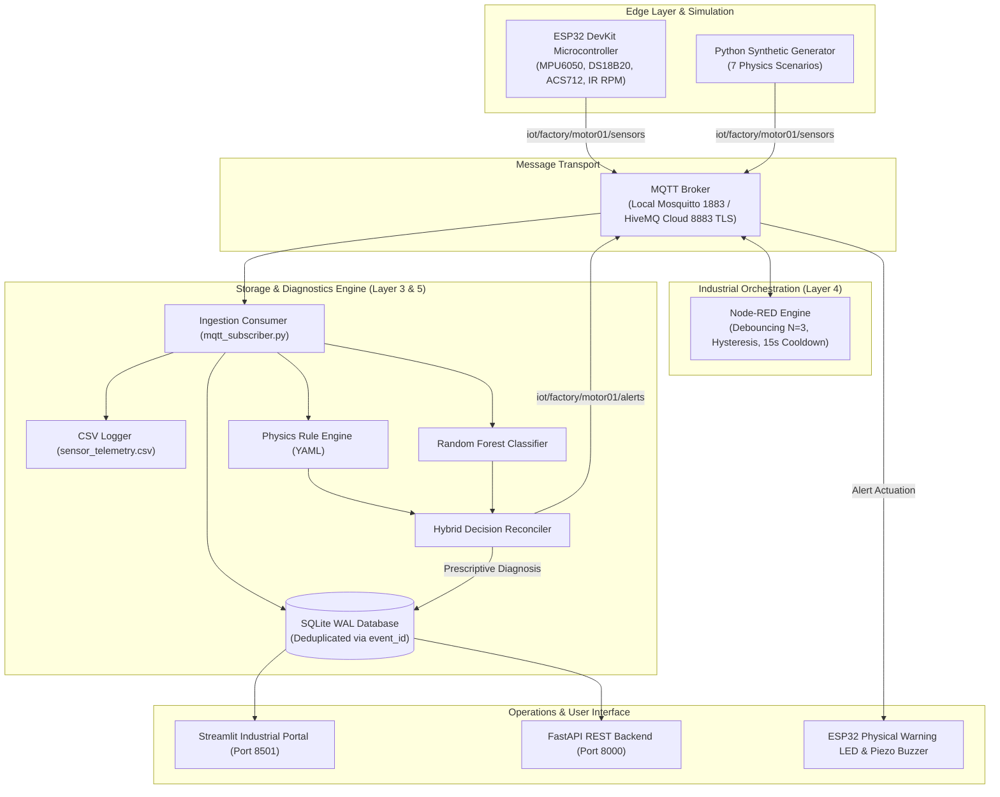

# Knowledge-Driven IoT-Based Fault Diagnosis System

[](https://apple.com)
[](https://python.org)
[](https://platformio.org)
[](https://nodered.org)
[](LICENSE)

An enterprise-grade, cyber-physical industrial monitoring system for a **12V DC motor asset**, built across six progressive engineering layers: from synthetic physics simulation, TLS cloud MQTT, and persistent SQLite database, through Node-RED automation, knowledge-driven AI/ML hybrid diagnosis, and non-blocking ESP32 edge firmware with physical alarm actuation.

---

## ⚡ Quick Start (One-Command Local Demo)

The entire system can be run immediately in local simulation mode without requiring physical hardware or paid cloud credentials:

```bash
# 1. Clone or navigate to the repository
cd "Fault Diagnosis System new"

# 2. Run initial setup (creates venv, applies migrations, seeds accounts, trains ML model)
./scripts/setup.sh

# 3. Launch one-command local demonstration
./scripts/run_demo.sh
```

- **Industrial Monitoring Portal**: Open [http://localhost:8501](http://localhost:8501)
- **FastAPI REST API**: Open [http://localhost:8000/docs](http://localhost:8000/docs)
- **Default Credentials**:
  - Administrator: `admin` / `Admin@2026`
  - Operator: `operator` / `Operator@2026`

---

## 🏗 The Six Mandatory Development Layers

| Layer | Milestone | Core Implementation Components | Verification Script |
|---|---|---|---|
| **Layer 1** | **Synthetic Data → MQTT → CSV → Dashboard** | Synthetic generator (7 physics scenarios), local Paho publisher, thread-safe CSV logger, live Streamlit polling charts. | `./scripts/run_layer1.sh` |
| **Layer 2** | **Cloud MQTT (HiveMQ TLS 8883) & Fallback** | TLS v1.2/1.3 client, exponential backoff, credential decoupling (`.env.example`), automatic local broker fallback. | `./scripts/run_layer2.sh` |
| **Layer 3** | **SQLite Historical Database (WAL Mode)** | SQLite 3 in WAL mode, `UNIQUE(event_id)` deduplication, schema migrations, composite index `(device_id, timestamp DESC)`. | `./scripts/run_layer3.sh` |
| **Layer 4** | **Node-RED Industrial Automation & Alerts** | Importable `nodered/flows.json`, consecutive fault debouncing ($N=3$), 15s cooldown, recovery notifications, Docker compose. | `./scripts/run_layer4.sh` |
| **Layer 5** | **Knowledge AI/ML + Auth + SaaS Dashboard** | Priority-ranked YAML rules, Random Forest with 10 rolling physics features, hybrid consensus reconciler, salted PBKDF2 login, dark SaaS theme. | `./scripts/run_layer5.sh` |
| **Layer 6** | **ESP32 Edge Hardware & Physical Alerts** | Arduino C++ firmware, MPU6050 AC-coupled vibration RMS, DS18B20 1-Wire, ACS712 auto-zero calibration, optical IR RPM ISR, LED/buzzer alarms. | `./scripts/run_layer6.sh` |

---

## 📐 System Architecture



---

## 🔌 Hardware Pin Mapping & Electrical Safety (Layer 6)

| Sensor / Actuator | ESP32 GPIO | Operating Voltage | Conditioning & Safety Requirement |
|---|---|---|---|
| **MPU6050 Accelerometer** | **GPIO 21 (SDA)**<br>**GPIO 22 (SCL)** | 3.3V | Powered from 3.3V rail. I2C bus utilizes 4.7kΩ pull-ups. |
| **DS18B20 Temp Probe** | **GPIO 4 (DQ)** | 3.3V | Requires external **4.7kΩ pull-up resistor** to 3.3V. |
| **ACS712-05B Current** | **GPIO 36 (ADC)** | 5V | **MUST use 10kΩ/20kΩ voltage divider** to scale 0–5V to safe 0–3.3V ADC. |
| **Optical Slot Tachometer** | **GPIO 18** | 3.3V | Optical slot interrupt on FALLING edge. |
| **Status Warning LED** | **GPIO 2** | 3.3V | In series with 330Ω current-limiting resistor to GND. |
| **Piezo Buzzer** | **GPIO 15** | 5V / 12V | Driven via 2N2222 NPN transistor with base resistor. |
| **12V DC Motor** | **L298N Driver** | 12V DC (External) | **COMMON GROUND** shared with ESP32; motor never driven directly from GPIO. |

---

## 🧪 Automated Testing

Execute the test suite covering schema compliance, deduplication, consensus logic, and REST routes:

```bash
# Run all 22 automated tests
./.venv/bin/pytest tests/ -v
```

---

## 📂 Repository Layout

```text
knowledge-driven-iot/
├── README.md                      # Primary project overview and instructions
├── IMPLEMENTATION_PLAN.md         # Layer-by-layer architectural plan
├── PROJECT_STATUS.md              # Detailed verification status report
├── .env.example                   # Environment configuration template
├── requirements.txt               # Pinned Python package dependencies
├── pyproject.toml                 # Pytest configuration
├── docker-compose.yml             # Docker stack for Mosquitto, Node-RED, Backend, UI
│
├── config/
│   ├── settings.py                # Strongly-typed environment settings
│   ├── thresholds.yaml            # Operational engineering thresholds
│   ├── devices.yaml               # Motor asset hardware specification
│   └── knowledge_base.yaml        # Declarative physics rule hypotheses
│
├── simulation/
│   ├── synthetic_generator.py     # 7-scenario physics telemetry generator
│   ├── mqtt_publisher.py          # Standalone Paho MQTT publisher
│   └── scenarios.py               # Operational regime parameter profiles
│
├── ingestion/
│   ├── mqtt_subscriber.py         # Authoritative ingestion & diagnosis consumer
│   ├── mqtt_client.py             # Managed client with TLS & exponential backoff
│   ├── csv_logger.py              # Thread-safe Layer 1 CSV persistence
│   └── data_validator.py          # Schema validation & deduplication cache
│
├── database/
│   ├── models.py                  # SQLite DDL schema (WAL mode, indexes)
│   ├── connection.py              # Thread-safe SQLite connection context manager
│   ├── repository.py              # Authoritative persistence repository
│   └── migrations/                # Versioned SQL migrations & runner
│
├── backend/
│   ├── main.py                    # FastAPI REST application
│   └── auth/security.py           # Salted PBKDF2 authentication & sessions
│
├── diagnosis/
│   ├── rule_engine.py             # Declarative YAML physics rule evaluator
│   ├── hybrid_engine.py           # Consensus reconciler (Rules + ML)
│   ├── recommendations.py         # Prescriptive maintenance action mapper
│   └── knowledge_base.py          # Knowledge base query & inspection interface
│
├── ml/
│   ├── train.py                   # Model training pipeline (Random Forest)
│   ├── predict.py                 # Real-time inference engine with rolling features
│   ├── evaluate.py                # Detailed tabular metric & confusion matrix evaluator
│   ├── features.py                # Rolling temporal feature engineering
│   └── models/                    # Saved .joblib model bundle & metrics
│
├── dashboard/
│   ├── app.py                     # Multi-page Streamlit portal with authentication
│   ├── pages/                     # 7 functional monitoring & diagnostics pages
│   ├── components/charts.py       # High-performance Plotly time-series visualizers
│   └── styles/theme.css           # Industrial dark charcoal UI theme
│
├── nodered/
│   ├── flows.json                 # Importable Node-RED automation workflow
│   ├── package.json               # Node-RED dependencies
│   └── README.md                  # Node-RED setup & hysteresis guide
│
├── firmware/esp32_motor_monitor/
│   ├── platformio.ini             # PlatformIO build configuration for ESP32
│   ├── src/main.cpp               # C++ firmware (RMS vibe, temp, current, RPM, alerts)
│   ├── include/config.h           # Firmware constants, pins, and calibration
│   └── README.md                  # Build, flash & calibration guide
│
├── tests/                         # Pytest automated test suites
├── scripts/                       # Executable launch & verification scripts
└── docs/                          # In-depth technical & academic documentation
```

---

## 📄 Academic Documentation

- [System Architecture](docs/ARCHITECTURE.md)
- [Layer 1 Guide](docs/LAYER_1.md)
- [Layer 2 Guide](docs/LAYER_2.md)
- [Layer 3 Guide](docs/LAYER_3.md)
- [Layer 4 Guide](docs/LAYER_4.md)
- [Layer 5 Guide](docs/LAYER_5.md)
- [Layer 6 Guide](docs/LAYER_6.md)
- [Hardware Wiring & Electrical Safety](docs/HARDWARE_WIRING.md)
- [REST API Specifications](docs/API.md)
- [Testing Methodology](docs/TESTING.md)
- [Troubleshooting & Recovery](docs/TROUBLESHOOTING.md)
- [Final Engineering Project Report](docs/PROJECT_REPORT.md)
