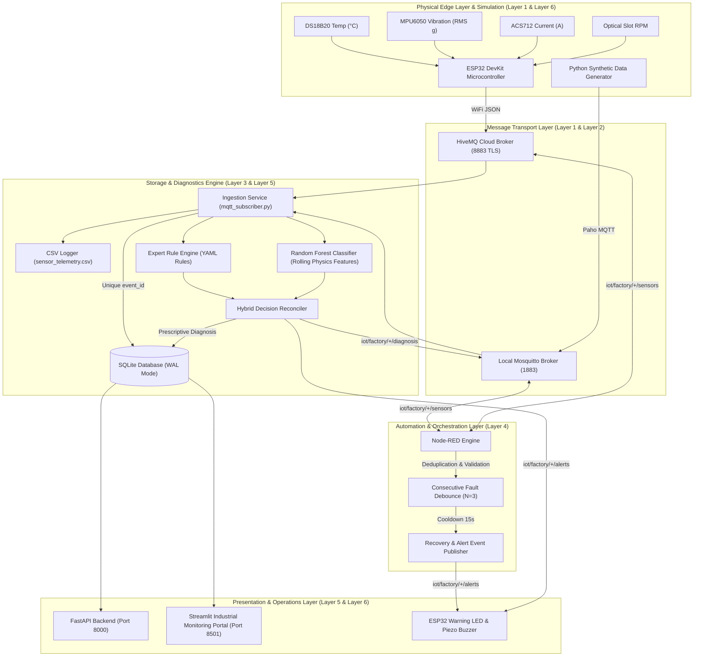

# System Architecture — Knowledge-Driven IoT Fault Diagnosis System

## 1. Executive Summary
The **Knowledge-Driven IoT-Based Fault Diagnosis System** is an industrial cyber-physical monitoring platform designed for a 12V DC motor asset. The architecture integrates edge sensor telemetry acquisition, cloud and local publish-subscribe messaging via MQTT, time-series data deduplication and persistence in SQLite WAL, industrial automation orchestration with Node-RED, and a hybrid AI diagnostic engine combining deterministic engineering rules with scikit-learn machine learning.

---

## 2. Six-Layer Modular Architecture



---

## 3. Communication Topic Topology

The MQTT topic hierarchy follows a clean industrial schema:

| MQTT Topic | Direction | Payload Schema | Purpose |
|---|---|---|---|
| `iot/factory/{device_id}/sensors` | Pub: ESP32 / Sim<br>Sub: Ingest / Node-RED | Standard Telemetry JSON | Raw sensor readings (T, V, I, RPM, status). |
| `iot/factory/{device_id}/status` | Pub: Device (LWT) | `{"device_id": "...", "status": "online/offline"}` | Device heartbeat and Last Will & Testament. |
| `iot/factory/{device_id}/diagnosis` | Pub: Hybrid Engine | Hybrid Diagnosis JSON | Inferred fault hypothesis, severity, confidence, and action. |
| `iot/factory/{device_id}/alerts` | Pub: Ingest / Node-RED<br>Sub: Dashboard / ESP32 | Alert JSON | Debounced notifications triggering physical buzzers or alarms. |
| `iot/factory/{device_id}/commands` | Pub: Operator<br>Sub: ESP32 | `{"command": "emergency_stop"}` | Remote safety de-energization. |
| `iot/factory/{device_id}/command_ack` | Pub: ESP32<br>Sub: Backend | `{"status": "executed"}` | Hardware command execution acknowledgement. |

---

## 4. Normalized Sensor Message Schema

Every telemetry packet adheres to the following JSON specification:

```json
{
  "event_id": "motor01-1730289600-0001",
  "device_id": "motor01",
  "timestamp": "2026-10-30T12:00:00.000Z",
  "source": "synthetic",
  "temperature_c": 38.5,
  "vibration_rms_g": 0.12,
  "current_a": 0.62,
  "rpm": 1980.0,
  "sensor_status": "ok"
}
```

---

## 5. Persistence Architecture (SQLite in WAL Mode)

SQLite is configured with `PRAGMA journal_mode = WAL` (Write-Ahead Logging) and `PRAGMA foreign_keys = ON`.
- **Concurrency**: WAL mode allows concurrent readers while a single background writer commits transactions without locking contention.
- **Deduplication**: `sensor_readings.event_id` enforces a `UNIQUE` constraint, preventing duplicate insertion when both Node-RED and direct subscriber are active.
- **Indexing**: Composite indexes on `(device_id, timestamp DESC)` enable sub-millisecond retrieval of recent telemetry and historical time windows.

---

## 6. Hybrid Intelligence Engine

The diagnostic engine reconciles deterministic engineering rules with a multi-class Random Forest model:
1. **Rule Engine**: Evaluates physics-based threshold boundaries defined in `config/knowledge_base.yaml`.
2. **Machine Learning Model**: Analyzes rolling temporal features (rate of temperature rise, vibration acceleration variance, torque-to-speed ratios).
3. **Consensus & Conflict Handling**:
   - When Rule Engine and ML reach consensus, diagnostic confidence is bolstered ($>90\%$).
   - When a discrepancy occurs, the system adopts a conservative safety stance (choosing the higher severity verdict), records the conflict flag, and lowers output confidence to alert human operators to uncertainty.
