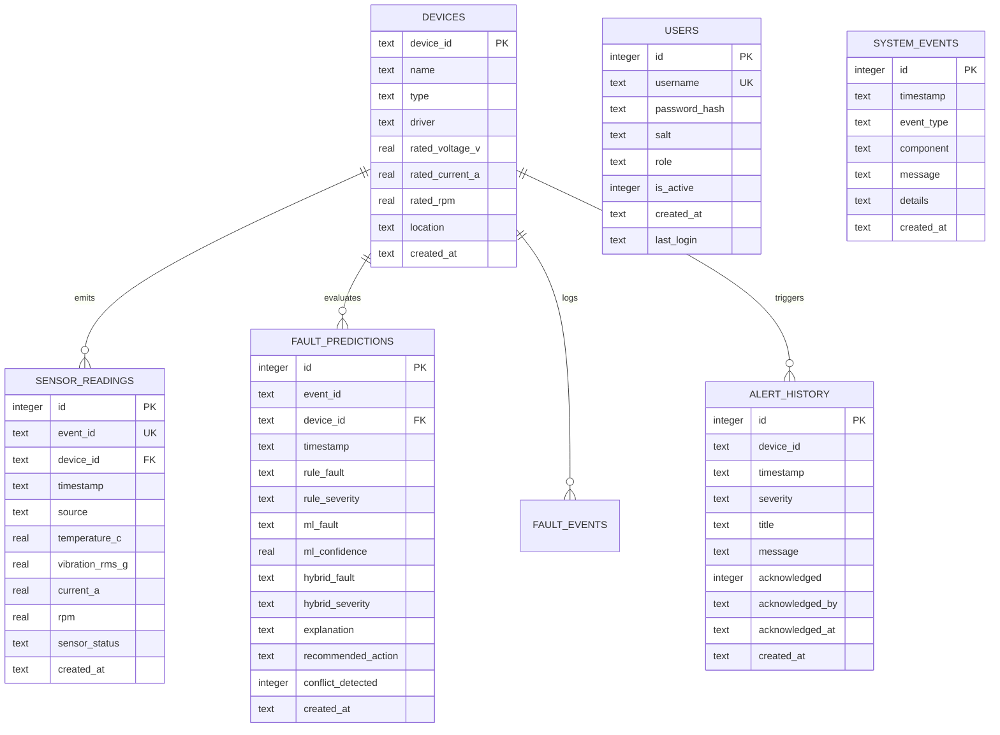

# Layer 3 — SQLite Historical Database & Analytics Repository

## 1. Objective
Establish an ACID-compliant, persistent relational database using SQLite in Write-Ahead Logging (WAL) mode. The database serves as the single source of truth for telemetry streams, hybrid diagnostic predictions, active and historical alerts, operator acknowledgements, user access control, and audit logs.

---

## 2. Relational Schema Architecture



---

## 3. Key Design Decisions

1. **Write-Ahead Logging (WAL)**: `PRAGMA journal_mode = WAL` enables concurrent readers while a single writer operates without blocking the UI.
2. **Event Deduplication**: The `event_id UNIQUE` constraint drops duplicate telemetry packets originating from network retransmissions.
3. **Historical Time-Range Queries**: The composite index `(device_id, timestamp DESC)` ensures efficient historical analytics and slicing across arbitrary date-time windows.
4. **Data Migrations**: Versioned SQL migrations (`database/migrations/001_initial_schema.sql`) are applied deterministically via `database/migrations/migrate.py`.

---

## 4. Verification & Execution
To run database migrations and execute the verification test suite:
```bash
./scripts/run_layer3.sh
```
Or run the dedicated pytest suite:
```bash
./.venv/bin/pytest tests/test_database.py -v
```
