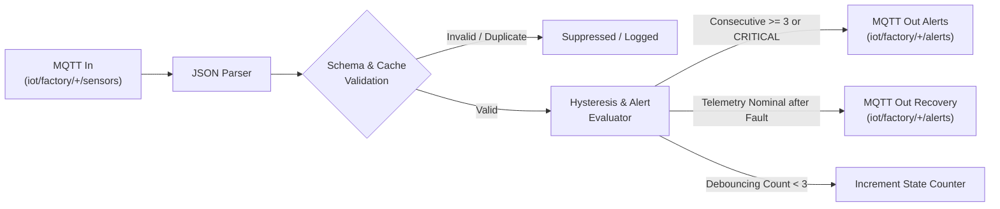

# Layer 4 — Node-RED Industrial Automation, Hysteresis & Alerts

## 1. Objective
Integrate **Node-RED** as the industrial automation and event-orchestration layer. The system subscribes to raw telemetry topics, enforces payload validation, tracks device health states, applies consecutive fault hysteresis ($N=3$) and cooldown timers ($15\,\text{s}$), suppresses duplicate alarms, publishes actionable alert events, and sends recovery notifications.

---

## 2. Industrial Orchestration Pipeline



---

## 3. Advanced Alert Management Logic

### A. Consecutive Fault Debouncing ($N = 3$)
To prevent transient spikes (e.g., normal motor inrush current upon startup) from triggering nuisance alarms, the engine requires $3$ consecutive anomalous telemetry readings before raising a persistent warning.
- *Exception*: Immediate `CRITICAL` conditions (e.g., Locked-Rotor Motor Stall or Severe Overheating) bypass the debouncer to protect machinery immediately.

### B. Cooldown Timer ($15\,\text{s}$)
Once an alert is dispatched, an alert cooldown timer prevents flooding the MQTT broker, database, and dashboard with redundant notifications.

### C. State Hysteresis & Recovery
When sensor values return within nominal safe thresholds after an active fault state, the system automatically dispatches a `severity: NORMAL` recovery message, notifying operators that the condition has resolved.

---

## 4. Verification & Execution
To run the automated hysteresis, cooldown, and recovery unit tests:
```bash
./scripts/run_layer4.sh
```
Or run the dedicated alert test suite:
```bash
./.venv/bin/pytest tests/test_alerts.py -v
```

To run Node-RED via Docker Compose:
```bash
docker compose up nodered -d
```
Access the web canvas at `http://localhost:1880`.
