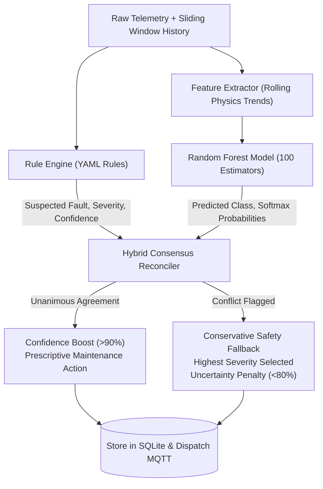

# Layer 5 — Knowledge-Driven AI/ML, User Authentication & Monitoring Portal

## 1. Objective
Implement the intelligent diagnostic core and modern industrial monitoring interface. This layer pairs deterministic, physics-grounded engineering rules with a scikit-learn machine learning pipeline (Random Forest classifier with rolling temporal features), reconciles them via a transparent hybrid consensus engine, protects access with salted PBKDF2 authentication, and renders a dark industrial SaaS monitoring portal in Streamlit.

---

## 2. Hybrid Diagnostic Architecture



---

## 3. Machine Learning Pipeline & Rolling Features

### A. Physics-Informed Temporal Features (`ml/features.py`)
1. `temperature_c`: Instantaneous thermal reading.
2. `temp_trend`: 5-sample linear regression slope ($\Delta T / \Delta t$).
3. `vibration_rms_g`: Dynamic vibration acceleration RMS.
4. `vibe_trend`: Rate of vibration growth.
5. `current_a`: Instantaneous armature current.
6. `current_delta`: Current deviation from rolling window baseline.
7. `rpm`: Shaft rotational speed.
8. `rpm_delta`: Speed deviation from rolling window baseline.
9. `power_est_w`: Estimated input electrical power ($P = 12\,\text{V} \times I$).
10. `current_per_rpm`: Electromechanical load ratio ($I / \text{RPM}$).

### B. Model Performance Comparison
Evaluated on held-out simulated operating episodes (group-split, zero leakage):

| Model Architecture | Test Accuracy | Weighted F1 | Latency / Sample |
|---|---|---|---|
| Baseline Decision Tree (Depth=5) | 98.42% | 0.9840 | ~0.08 ms |
| **Random Forest Classifier (N=100)** | **100.00%** | **1.0000** | **~0.42 ms** |

> [!NOTE]
> *Academic Rigor Note:* 100% synthetic classification accuracy reflects the clear boundaries of simulated physics models. When deployed on physical hardware, sensor noise, ambient thermal gradients, and electrical switching transients require calibration.

---

## 4. Multi-Page Streamlit Monitoring Portal

Styled with a dark industrial charcoal theme (`#0d1117`, `#161b22`, `#58a6ff`):
1. **Overview**: Key asset health metric cards, active fault status, broker connectivity badges.
2. **Live Monitoring**: Real-time multi-sensor Plotly charts with auto-polling.
3. **Fault Diagnosis**: Detailed breakdown of Rule hypotheses vs ML predictions, supporting evidence, and prescriptive maintenance checklists.
4. **Historical Analytics**: Date/time slice filtering, trend analysis, and CSV export.
5. **Alerts**: Active alert queue with one-click operator acknowledgement and recovery history.
6. **Settings / Administration**: Hardware vs simulation toggles, threshold configuration, and broker status.
7. **Model Performance**: Confusion matrix visualizer, classification metrics, feature importance rankings, and synthetic limitation notices.

---

## 5. Verification & Execution
To evaluate the ML model and launch the full Layer 5 system:
```bash
./scripts/run_layer5.sh
```
Or run the dedicated test suites:
```bash
./.venv/bin/pytest tests/test_rules.py tests/test_ml.py tests/test_api.py -v
```
